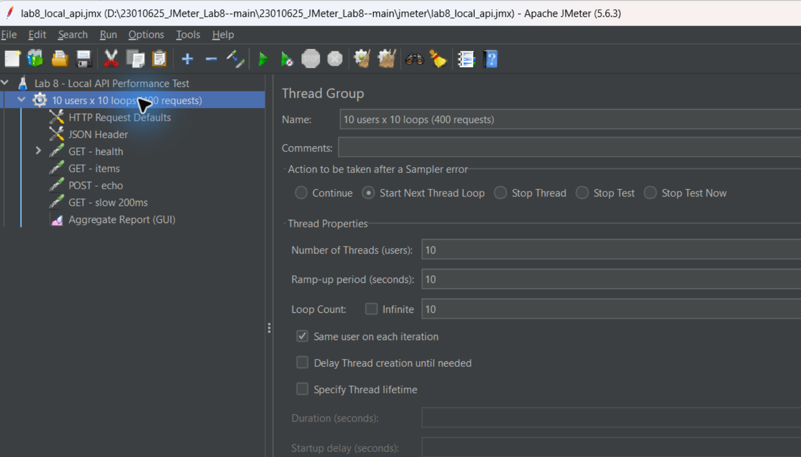
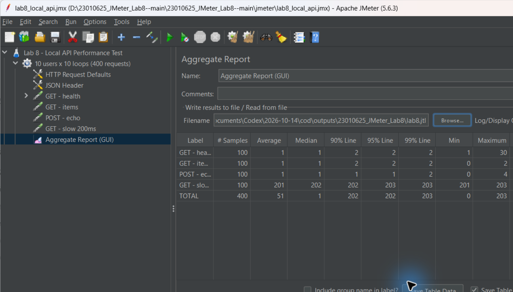

# LAB 8 — KIỂM THỬ HIỆU NĂNG VỚI APACHE JMETER

**Sinh viên:** Trần Văn Nhật · **MSSV:** 23010625  
**Môn học:** Kiểm thử phần mềm · **Bài thực hành:** Lab 8

> **Trạng thái:** Đã chạy JMeter 5.6.3 trên Windows và ghi nhận **400 samples** qua Aggregate Report (ảnh người thực hiện cung cấp, ngày 14/10/2026). Chưa xác nhận Error % / Throughput do hai cột này nằm ngoài ảnh; ảnh gốc cần tải lên `screenshots/` để hiển thị trong báo cáo.

## 1. Mục tiêu

- Tìm hiểu Apache JMeter: Test Plan, Thread Group, HTTP Request, Assertions và Listener.
- Tạo hệ thống API nhỏ để kiểm thử trên **localhost**, tránh gây tải lên website của bên thứ ba.
- Thiết kế tải đồng thời và đo thời gian phản hồi, throughput, tỷ lệ lỗi, percentiles.
- Chụp ảnh màn hình cấu hình và kết quả, đưa vào README của GitHub.

## 2. Lý thuyết Apache JMeter

Apache JMeter là công cụ mã nguồn mở dùng để kiểm thử tải (load testing) và đo hiệu năng HTTP API, web services và nhiều giao thức khác. **Thread Group** cấu hình số người dùng ảo, ramp-up và số vòng lặp. **HTTP Request** gửi yêu cầu. **Assertion** xác nhận kết quả kỳ vọng. **Listener** hiển thị và tổng hợp số liệu.

| Thuật ngữ | Ý nghĩa |
|---|---|
| Samples | Tổng số yêu cầu đã thực hiện |
| Average / Median (ms) | Thời gian phản hồi trung bình / trung vị |
| 90th / 95th / 99th percentile | Mốc thời gian mà 90% / 95% / 99% yêu cầu không vượt quá |
| Throughput | Số yêu cầu hệ thống xử lý trong một đơn vị thời gian |
| Error % | Tỷ lệ request không đạt kết quả kỳ vọng |
| Ramp-up | Thời gian tăng dần đến số user đã cấu hình |

**Tài liệu học:** [Trang Apache JMeter](https://jmeter.apache.org/) · [User Manual](https://jmeter.apache.org/usermanual/index.html) · [Getting Started](https://jmeter.apache.org/usermanual/get-started.html).

## 3. Cấu trúc repository

```text
23010625_JMeter_Lab8-/
├── README.md                 # Báo cáo và hướng dẫn
├── api/
│   ├── __init__.py
│   └── server.py             # API Python chạy trên localhost:8000
├── jmeter/
│   └── lab8_local_api.jmx    # Kịch bản JMeter
├── tests/
│   └── test_api.py           # Test chức năng độc lập
├── screenshots/              # Bổ sung ảnh chụp thật sau khi chạy
└── .gitignore
```

## 4. API được kiểm thử

API mẫu sử dụng thư viện chuẩn Python, không cần cài thêm thư viện.

| HTTP | Endpoint | Kết quả kỳ vọng |
|---|---|---|
| GET | `/health` | 200, `{"status":"ok"}` |
| GET | `/api/items` | 200, JSON danh sách 3 sản phẩm |
| POST | `/api/echo` | 200, trả lại JSON đã gửi |
| GET | `/api/slow` | 200, trì hoãn mô phỏng khoảng 200 ms |

Khởi động tại thư mục gốc (Python 3):

```bash
python -m api.server
```

Mở một terminal khác và xác nhận API:

```bash
python -m unittest discover -s tests -v
```

Truy cập `http://127.0.0.1:8000/health` để xem phản hồi.

## 5. Cài đặt và chạy JMeter

1. Cài Java theo yêu cầu phiên bản JMeter đang sử dụng; tải JMeter từ [trang chính thức](https://jmeter.apache.org/download_jmeter.cgi).
2. Giải nén, chạy `bin/jmeter.bat` (Windows) hoặc `bin/jmeter` (Linux/macOS).
3. **Giữ API Python chạy** trên máy cùng lúc.
4. JMeter → **File → Open** → chọn `jmeter/lab8_local_api.jmx`.
5. Kiểm tra Thread Group, HTTP Request Defaults và 4 HTTP Request.
6. Chạy thử nhỏ bằng nút **Start**; xem **Aggregate Report**. Để kiểm thử tải chính thức, dùng non-GUI theo lệnh bên dưới.

### Cấu hình test plan

| Tham số | Giá trị |
|---|---|
| Users (threads) | 10 |
| Ramp-up | 10 giây |
| Loops mỗi user | 10 |
| Samplers mỗi loop | 4 |
| Tổng requests **dự kiến** | 10 × 10 × 4 = **400** |
| Đích | `127.0.0.1:8000` |

Kết quả kiểm thử được cung cấp xác nhận **400 requests thực tế** (100 requests/API).

### Chạy non-GUI và xuất báo cáo HTML

Mở terminal ở thư mục gốc repo, đảm bảo `jmeter` nằm trong PATH. Trước **mỗi lần chạy**, xóa hoặc đổi tên thư mục output cũ để đường dẫn `results/html` chưa tồn tại (JMeter yêu cầu report directory trống).

**Windows PowerShell:**

```powershell
New-Item -ItemType Directory -Force results | Out-Null
jmeter -n -t jmeter/lab8_local_api.jmx -l results/lab8.jtl -e -o results/html
```

**Linux/macOS:**

```bash
mkdir -p results
jmeter -n -t jmeter/lab8_local_api.jmx -l results/lab8.jtl -e -o results/html
```

Mở `results/html/index.html` để xem biểu đồ và thống kê. Thư mục `results` được bỏ qua trong Git; nếu muốn nộp số liệu, hãy chọn kết quả phù hợp và loại bỏ mọi dữ liệu nhạy cảm trước khi commit.

## 6. Các trường hợp kiểm thử

| Test case | Mục đích | Tiêu chí quan sát |
|---|---|---|
| TC01 GET /health | Kiểm tra health endpoint | HTTP 200; Error % |
| TC02 GET /api/items | Đọc danh sách sản phẩm | Response time, throughput |
| TC03 POST /api/echo | Gửi/nhận payload JSON | HTTP 200, response body |
| TC04 GET /api/slow | API có độ trễ chủ động | Average, P95, P99 |

**Lưu ý:** Test plan đã có HTTP 200 assertion cho TC01. Các request khác được kiểm tra lỗi HTTP qua JMeter; đối chiếu nội dung response bằng GUI khi nghiệm thu. Với TC04, thời gian phản hồi có thể lớn hơn 200 ms do overhead và scheduler.

## 7. Báo cáo kết quả thực nghiệm (14/10/2026)

**Nguồn dữ liệu:** Hai ảnh chụp giao diện Apache JMeter **5.6.3** do sinh viên thực hiện cung cấp: (1) Thread Group / cây Test Plan; (2) Aggregate Report. Các giá trị được chép theo đúng cột nhìn thấy trên ảnh, đơn vị thời gian là **ms**.

### 7.1. Cấu hình quan sát được

- **Thread Group:** `10 users x 10 loops (400 requests)`.
- **Number of Threads:** 10; **Ramp-up:** 10 giây; **Loop Count:** 10.
- **4 samplers:** `GET - health`, `GET - items`, `POST - echo`, `GET - slow 200ms`.
- Có `HTTP Request Defaults`, `JSON Header` và `Aggregate Report (GUI)`.
- Ảnh cho thấy lựa chọn xử lý lỗi ở Thread Group là **Start Next Thread Loop**. Đây là cấu hình quan sát được trên máy tại lúc chụp, khác giá trị `Continue` trong test plan nguồn của repository; nếu cần tái lập giống ảnh, hãy chỉnh lại tùy chọn này trong GUI.

### 7.2. Số liệu Aggregate Report

| Label | # Samples | Average (ms) | Median (ms) | P90 (ms) | P95 (ms) | P99 (ms) | Min (ms) | Max (ms) |
|---|---:|---:|---:|---:|---:|---:|---:|---:|
| GET - health | 100 | 1 | 1 | 2 | 2 | 2 | 1 | 30 |
| GET - items | 100 | 1 | 1 | 2 | 2 | 2 | 0 | 2 |
| POST - echo | 100 | 1 | 1 | 1 | 1 | 2 | 0 | 4 |
| GET - slow 200ms | 100 | 201 | 202 | 202 | 203 | 203 | 201 | 203 |
| **TOTAL** | **400** | **51** | **1** | **202** | **202** | **203** | **0** | **203** |

**Giới hạn ảnh chụp:** Không thấy cột `Error %`, `Throughput`, `Received KB/sec` và `Sent KB/sec` trong khung hình. Vì vậy **chưa đủ dữ liệu để kết luận 0% lỗi hoặc ghi con số throughput**. Cần kéo bảng Aggregate Report sang phải và chụp bổ sung.

### 7.3. Phân tích kết quả

- Đủ **400 samples**, tương ứng **100 samples cho mỗi API**: khẳng định test plan đã thực thi các request, không còn tình trạng chỉ tạo rồi kết thúc thread mà không có samples.
- Ba endpoint `GET /health`, `GET /api/items`, `POST /api/echo` có **Average = 1 ms** trong lần đo này.
- Endpoint `GET /api/slow` có **Average = 201 ms**, **P95 = 203 ms**, phù hợp với độ trễ mô phỏng khoảng 200 ms trong mã nguồn.
- Giá trị **Average tổng = 51 ms** bao gồm cả endpoint cố ý trì hoãn, không dùng riêng chỉ số này để đánh giá mọi endpoint.
- Thời gian đo trong localhost, 10 users và 10 loops là một phép thử học tập, **chưa chứng minh năng lực xử lý tải lớn hoặc hiệu năng production**.

### 7.4. Hình minh họa

Hai ảnh sau là ảnh chụp JMeter thực tế do sinh viên cung cấp. **Cần tải hai file ảnh lên repository với đúng đường dẫn bên dưới** để GitHub hiển thị chúng trong README.

**Hình 1 — Cấu hình Thread Group và cây Test Plan**



**Hình 2 — Aggregate Report với 400 samples và thời gian phản hồi các API**



**Ảnh cần bổ sung:** chụp thêm màn hình có các cột `Error %`, `Throughput`; nếu được, thêm ảnh `View Results Tree` kiểm tra response code / response body, và ảnh chạy API Python.

## 8. Nhận xét và kết luận

Từ ảnh Aggregate Report, bài kiểm thử đã thực thi đủ **400 samples**; endpoint có độ trễ mô phỏng chậm hơn rõ rệt so với ba endpoint còn lại. Cần chụp thêm **Error %**, **Throughput** và kiểm tra response body để đánh giá đầy đủ độ chính xác và khả năng xử lý tải.

**Kết luận:** Đã xây dựng API mẫu, test plan JMeter và có bằng chứng đo thời gian phản hồi trên máy Windows. Việc đưa ảnh gốc vào repository và xác nhận tỷ lệ lỗi là các bước hoàn thiện còn lại.

---
*Tác giả: Trần Văn Nhật — 23010625 | Lab 8 Apache JMeter*
